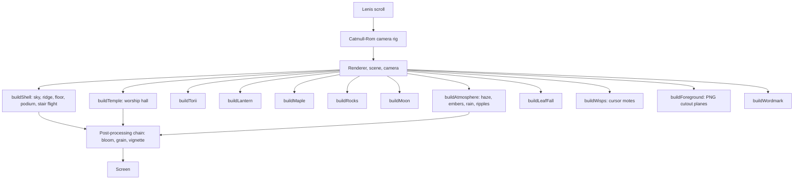

# Procedural 3D World Guide

The whole temple environment is generated in `index.html` with Three.js. There are no `.gltf` or `.obj` files; geometry, materials and most textures are built in code. The only image files in the scene are the WebP cutout layers used as foreground planes.

The scene code lives in section 5 of the inline script ("the world"). Each builder is a function, so a piece can be disabled by commenting out its call.

## What each builder makes

| Builder | Result |
|---|---|
| `buildShell` | Sky dome, the wooded ridge that closes the valley, floor, podium, and the flight of stone steps (26 risers merged into one buffer) |
| `buildTemple` | The worship hall: lit lattice bays between dark columns, pent roof, railed upper gallery with a name plaque, main roof, two flanking wings, and a glow spilling over the steps |
| `buildTorii` | A vermilion torii built from columns, nuki, gakuzuka, shimaki and kasagi beams |
| `buildLantern` | Stone lanterns with a warm light source |
| `buildMaple` | Maple trees with leaves that move in the wind |
| `buildRocks` | Rocks placed around the approach |
| `buildMoon` | The large vermilion moon and a weak corona that the bloom picks up |
| `buildAtmosphere` | Drifting haze slabs, embers around the lantern and moon, rain in the slot of open sky, ripples on standing water |
| `buildLeafFall` | A recycled field of falling leaves, respawned ahead of the camera |
| `buildWisps` | Soft motes that trail the pointer |
| `buildForeground` | The transparent WebP cutouts (grass, branches, stones, walls) placed as planes sized against the frustum |
| `buildWordmark` | The giant wordmark set to the frame width |

## Rendering notes

- The podium and the stair flight use a planar-mirror shader for reflections (section 6).
- The post-processing chain (section 7) is a custom ping-pong setup using `THREE.ShaderMaterial` quads, not Three.js's `EffectComposer`. Add `?post=0` to the URL to bypass it.
- Many small pieces are merged into single buffers, or drawn with `InstancedMesh`, to keep draw calls down.

## About `src/shaders/`

The `.glsl` files in `src/shaders/` are small standalone reference snippets. `index.html` does not load them; the shaders the site actually runs are defined inline in the script.
